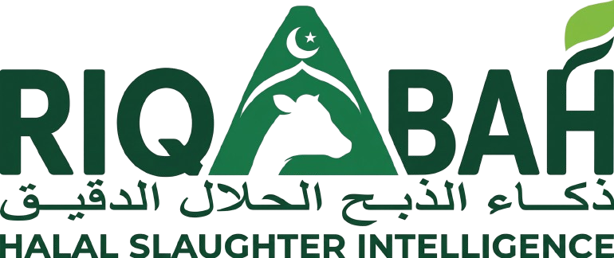

<!--
RIQABAH | Halal Slaughterhouse Intelligence
Product positioning: Fully Integrated and Operational
Saudi Arabia: market expansion and localisation opportunity; not a claim of regulatory approval.
-->

<p align="center">
  
</p>

<h1 align="center">RIQABAH</h1>

<h3 align="center">Halal Slaughterhouse Intelligence</h3>

<p align="center">
  <em>ذكاء عمليات الذبح الحلال</em><br>
  <strong>Connected Operations. End-to-End Halal Traceability. Evidence-Led Halal Assurance.</strong>
</p>

<p align="center">
  <a href="#platform-readiness"></a>
  <a href="#technology-stack"></a>
  <a href="#technology-stack"></a>
</p>

---

**From Animal Intake to Global Halal Markets. From Connected Operations to Traceable Evidence.**

RIQABAH is an integrated digital intelligence platform for halal slaughterhouses and meat-processing operations. It connects operational workflows and records across livestock intake, slaughter activities, halal control points, carcass handling, cutting, further processing, quality assurance, inventory, cold-chain monitoring, traceability, audit support, and export documentation.

The platform brings operational applications and intelligence capabilities into one ecosystem to help organisations improve visibility, organise evidence, identify exceptions, and make better-informed operational decisions across the halal meat value chain.

RIQABAH was initially shaped around New Zealand halal slaughter and export-market workflows. Its platform capabilities also create an opportunity to explore deployment and localisation for the Kingdom of Saudi Arabia (KSA), subject to local partner engagement, operational discovery, integration requirements, and applicable Saudi regulatory and halal-assurance processes.

**One connected platform. Halal integrity. Traceability from origin to destination.**

---

## Platform Readiness

**Platform positioning: Fully Integrated and Operational.**

RIQABAH has been developed as a connected platform with six integrated applications:

| Application | Primary role |
|---|---|
| Admin Web | Platform administration, configuration, user and access oversight |
| Auditor Web | Audit planning, assessment workflows, findings, and evidence review |
| Operations Web | Operational workflows and facility-level activity management |
| Mobile Auditor | Mobile access for field inspection, audit activities, and evidence capture |
| Public Verification Web | Public-facing verification experiences for supported records |
| Surveillance Web | Operational monitoring and oversight views |

The platform incorporates AI-enabled intelligence, GPS-related capabilities, QR-based identification or access workflows, and monitoring features. The exact availability of each function depends on the configured module, deployment environment, connected devices, and data integrations.

Platform readiness describes the state of the developed product. It does **not** imply that a specific Saudi facility has already deployed RIQABAH, that local integrations have been completed, or that a regulator or halal authority has certified, endorsed, or approved the platform.

## Why RIQABAH

Halal meat operations involve more than a final product label. Assurance depends on connected activities, controlled processes, reliable records, traceability, equipment and facility conditions, competent personnel, and evidence that can be reviewed.

RIQABAH is designed to help bring those operational records together. It supports organisations in moving from disconnected records and isolated workflows toward a more structured, visible, and evidence-led operating environment.

Key objectives include:

- Improve visibility across animal intake, slaughter, processing, storage, and dispatch.
- Connect relevant records to batches, products, facilities, and operational events.
- Support consistent documentation of halal control points and inspection activities.
- Surface missing records, inconsistencies, and potential exceptions for human review.
- Strengthen audit preparation and corrective-action follow-up.
- Support traceability and verification workflows for business partners and authorised stakeholders.

## Built for the Halal Meat Value Chain

RIQABAH is designed to support organisations across the halal meat ecosystem:

- **Halal abattoirs and slaughter facilities** — Animal intake, batch records, ante-mortem checks, slaughter events, halal control points, post-mortem inspection, and production traceability.
- **Meat-processing companies** — Carcass identification, cutting operations, production batches, packaging, and product genealogy.
- **Meat manufacturers** — Raw materials, ingredients, processing records, finished products, and batch relationships.
- **Cold storage and warehousing** — Inventory visibility, batch locations, storage records, and temperature-monitoring integrations.
- **Distributors and wholesalers** — Product identification, stock movements, batch visibility, and supply-chain coordination.
- **Exporters and international suppliers** — Halal consignment traceability, supporting documents, certificate references, and destination-market workflows.
- **Auditors and assurance stakeholders** — Audit workflows, findings, corrective actions, evidence management, and review support.
- **Integrated halal enterprises** — Connected workflows, teams, facilities, and operational oversight.

Workflows and integrations are configured according to each organisation's requirements, available data, equipment, and operating environment.

## Core Capabilities

### 1. Halal Operations Intelligence
Connect animal intake, slaughter, halal control points, processing, inventory, and operational information to improve visibility across halal business activities.

### 2. End-to-End Halal Traceability
Relate livestock and incoming materials to slaughter events, carcasses, processing batches, packaged products, and outbound consignments.

### 3. Quality and Assurance Management
Organise inspection records, halal checks, quality checks, non-conformances, corrective actions, and supporting evidence.

### 4. Halal Assurance and Compliance Support
Support structured operational records, documentation, review workflows, halal control-point records, and evidence organisation against requirements defined by the relevant organisation and competent authorities.

### 5. Audit Readiness and Evidence Management
Support audit preparation through structured records, traceability, evidence management, exception handling, findings, and corrective-action workflows. RIQABAH supports assurance processes; it does not issue halal certification or replace an authorised auditor or certification body.

### 6. Cold-Chain and Equipment Intelligence
Support equipment and temperature-monitoring workflows where suitable sensors, devices, and integrations are configured. Monitoring data and alerts can help operational teams investigate conditions that may affect product quality or food-safety controls.

### 7. Supply Chain and Export Intelligence
Connect batch information, inventory movements, consignment records, certificate references, and export-supporting documentation for destination markets.

### 8. AI-Assisted Intelligence
AI-enabled capabilities can assist with reviewing operational information, highlighting missing or inconsistent records, identifying unusual patterns, and surfacing potential risks or exceptions for qualified personnel to assess. AI outputs are decision-support signals, not regulatory determinations or substitutes for human judgement.

### 9. GPS and QR-Enabled Workflows
GPS-related capabilities can support location-aware field activities where enabled. QR workflows can support identification, retrieval, and verification of linked records according to deployment configuration.

### 10. Operational Surveillance
Surveillance and monitoring capabilities help authorised users view relevant operational information and monitoring feeds. CCTV and connected-device availability depends on facility infrastructure, permissions, and integration configuration.

## Six-Application Ecosystem

RIQABAH connects six purpose-built applications around shared operational workflows:

1. **Admin Web** — Administration and platform-level oversight.
2. **Auditor Web** — Audit and assessment workflows.
3. **Operations Web** — Facility and operational management.
4. **Mobile Auditor** — Field-based audit and inspection workflows.
5. **Public Verification Web** — Access to supported verification information.
6. **Surveillance Web** — Monitoring and operational oversight.

The applications are intended to work as parts of one platform rather than as unrelated standalone products. User roles, access policies, data availability, and deployment configuration determine what each stakeholder can view or perform.

## End-to-End Halal Traceability

RIQABAH is designed to connect records throughout the halal meat production lifecycle:

```text
Livestock / Raw Material Origin
              |
              v
Animal Intake and Identification
              |
              v
Animal Batch / Receiving Batch
              |
              v
Ante-Mortem / Receiving Checks
              |
              v
Slaughter Activities and Halal Control Points
              |
              v
Post-Mortem / Quality Inspection
              |
              v
Carcass / Raw Material Identification
              |
              v
Cutting and Further Processing
              |
              v
Production and Packaging
              |
              v
Finished Product / Meat Batch
              |
              v
Cold Storage and Inventory
              |
              v
Distribution / Consignment
              |
              v
Export and Destination-Market Documentation
```

The depth of traceability depends on the records captured, identification practices, process discipline, and integrations implemented at each facility.

## Opportunity in the Kingdom of Saudi Arabia

Saudi Arabia represents a relevant market to explore for RIQABAH because of the importance of halal food, meat supply chains, food quality, and assurance across slaughter, processing, storage, distribution, and import/export activities.

Potential application areas include:

- **Slaughterhouse digitisation** — Structured intake, batch, slaughter, inspection, and operational records.
- **Halal process visibility** — Evidence capture and review around defined halal control points.
- **Meat-processing traceability** — Connections between carcasses, processing batches, packaging, and finished products.
- **Cold-chain and facility monitoring** — Connected monitoring workflows where sensors and facility systems can be integrated.
- **Audit and inspection support** — Mobile and web-based workflows for authorised audit and operational personnel.
- **Supply-chain transparency** — QR-supported access to selected traceability or verification information, subject to data governance and permissions.
- **Multi-site oversight** — Consolidated operational visibility for organisations managing multiple facilities, where deployment architecture and permissions support it.

### Saudi Localisation Considerations

A Saudi deployment should begin with discovery and validation rather than assuming that a configuration developed for another market can be transferred unchanged.

Localisation work may include:

- Arabic-first user experience and appropriate English-language support.
- Mapping workflows to the participating facility's processes and local operating terminology.
- Reviewing applicable Saudi requirements with qualified local regulatory, halal, food-safety, and industry stakeholders.
- Defining data ownership, privacy, access control, hosting, and cybersecurity requirements.
- Assessing integrations with facility equipment, sensors, identity systems, and existing enterprise software.
- Validating reports, records, and evidence formats with the relevant local stakeholders.
- Training users and agreeing operational support arrangements.

RIQABAH is an operational technology platform. It does not replace the responsibilities or decisions of Saudi regulators, competent authorities, halal certification bodies, veterinarians, inspectors, or authorised auditors. Any local regulatory mapping, certification-related use, or formal integration must be validated with the relevant authorities and partners.

## Collaboration Opportunity with PUAS

RIQABAH and **PUAS** could explore a structured collaboration to assess and develop the platform's opportunity in Saudi Arabia. The proposed approach is a partnership discussion, not a statement that a formal partnership or deployment is already in place.

Potential collaboration areas include:

| Workstream | Potential contribution |
|---|---|
| Saudi market access | PUAS guidance on market entry, stakeholder introductions, and local business context |
| Local discovery | Joint engagement with slaughterhouses, processors, and relevant industry stakeholders |
| Pilot definition | Select a suitable facility, use cases, success measures, scope, and operational owners |
| Localisation | Coordinate Arabic UX, workflow terminology, local requirements review, and deployment planning |
| Implementation ecosystem | Explore local technology, equipment, integration, and operational partners |
| Commercial development | Evaluate customer segments, delivery model, pricing assumptions, and go-to-market options |
| Company and programme pathway | Discuss the appropriate Saudi setup, founder pathway, and programme requirements with PUAS |

### Proposed Collaboration Phases

**Phase 1 — Alignment and Discovery**
- Confirm strategic fit, target customer profile, and stakeholder priorities.
- Identify one or more candidate facilities and operational use cases.
- Review local requirements, data governance, infrastructure, and integration needs.

**Phase 2 — Pilot Design**
- Agree the pilot scope, baseline, responsibilities, timeline, and success criteria.
- Select the workflows and RIQABAH applications relevant to the facility.
- Define the required data, devices, integrations, training, and support.

**Phase 3 — Localisation and Pilot Execution**
- Configure the agreed workflows and Arabic user experience.
- Integrate only the systems and devices included in the agreed scope.
- Train participating users and execute the pilot with operational oversight.

**Phase 4 — Evaluation and Scale Decision**
- Review adoption, workflow completion, traceability coverage, evidence quality, exception handling, and user feedback.
- Document gaps, improvements, and the resources required for wider deployment.
- Decide jointly whether to extend, adapt, commercialise, or discontinue the pilot.

Pilot duration, budget, facility participation, commercial terms, and deliverables should be agreed by the parties before execution. No free pilot, customer commitment, or regulatory endorsement is implied.

## Value Proposition for Potential Saudi Partners

RIQABAH offers a platform foundation that local partners can evaluate against practical operational needs:

- A connected six-application ecosystem rather than a single-purpose dashboard.
- Digital workflows spanning operations, audit, mobile field work, verification, and surveillance.
- AI-enabled, GPS-related, and QR-supported capabilities within the platform.
- A traceability-oriented data approach across relevant stages of the meat value chain.
- A configurable foundation for local discovery, integration, and phased deployment.

The business case should be established through facility-level discovery and a measured pilot. Expected benefits such as reduced manual administration, improved record completeness, faster evidence retrieval, or better operational visibility should be treated as outcomes to validate, not guaranteed results.

## Technology Stack

RIQABAH's stated technology stack includes:

- **Web applications:** Next.js
- **Backend services:** Go
- **Mobile application:** Flutter
- **Database:** PostgreSQL

Deployment architecture, cloud or on-premises requirements, security controls, integration interfaces, and operating procedures should be assessed for each target environment.

## Governance, Assurance, and Responsibility

RIQABAH is designed to support operational assurance, traceability, evidence organisation, and decision support.

It does not independently:
- Issue halal certificates or determine halal status.
- Replace regulators, competent authorities, certification bodies, veterinarians, inspectors, or authorised auditors.
- Guarantee regulatory compliance, food safety, or export acceptance.
- Validate the accuracy of source data without appropriate controls and verification.

Organisations remain responsible for their operations, source records, personnel, approvals, and compliance obligations. AI outputs and automated alerts require review by appropriately qualified personnel.

## Project Direction

RIQABAH's product direction is to help halal meat businesses connect operational execution with traceable records and evidence-led assurance. The next stage for Saudi Arabia is to validate local needs with credible partners, define a practical pilot, and adapt the platform to the requirements of the participating facilities and relevant authorities.

We welcome discussions with slaughterhouse operators, meat processors, technology and integration providers, industry stakeholders, and potential local partners.

## About the Project

**RIQABAH — Halal Slaughterhouse Intelligence**  
Developed by **PT DIGI MEDIA KOMUNIKA**  
Founder: **Azwar Riyadh Subarkah**  
Languages: Arabic, English, and Indonesian  
Contact: **ptdigimediakomunika@gmail.com**

For partnership discussions, Saudi market exploration, or pilot scoping, please contact us.

---

## Important Positioning Note

“Fully Integrated and Operational” describes the product's stated platform readiness. It should not be interpreted as proof of deployment at a Saudi facility, Saudi regulatory approval, halal certification, a signed PUAS partnership, or verified commercial outcomes. Those milestones require separate evidence and agreement.

## Repository

This repository contains the RIQABAH project source and supporting materials. Refer to the project documentation and deployment configuration for implementation details.
